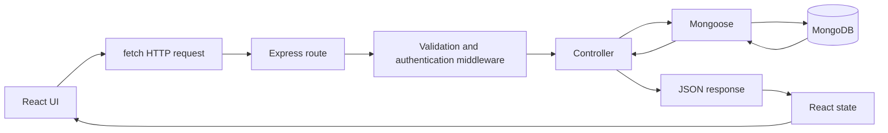

# Historical guide

This guide describes the earlier implementation. Authentication, currency calculations, pagination and test setup have since changed. Read [SECURITY_CURRENCY_UPGRADE.md](SECURITY_CURRENCY_UPGRADE.md) and [README.md](README.md) for the current contracts and run instructions.

# Understanding Fatortak

## 1. What Fatortak does

Fatortak organizes personal and business finances. Personal accounts record expenses, set monthly budgets and see spending summaries. Business accounts manage customers, suppliers, sales invoices, purchase invoices, operating expenses, a business profile and monthly financial reports.

The frontend uses actual records from the existing backend. It does not seed demo balances or invent financial trends. The login illustration is decorative.

## 2. Technologies

| Technology         | Purpose in this project                                            |
| ------------------ | ------------------------------------------------------------------ |
| JavaScript         | The language used on the frontend and backend                      |
| React / React DOM  | Build components, update UI from state and mount it in the browser |
| Vite               | Development server and production build tool                       |
| React Router       | Select pages from URLs and support nested/protected navigation     |
| CSS                | Responsive layouts, forms, tables, colors and focus states         |
| fetch              | Send HTTP requests from the browser                                |
| Node.js / Express  | Run the server and handle API requests                             |
| MongoDB / Mongoose | Store documents; define schemas, validation, queries and indexes   |
| bcrypt             | Hash passwords and verify login passwords                          |
| JWT / jsonwebtoken | Issue and verify signed authentication tokens                      |
| dotenv / cors      | Load server configuration and permit browser origins               |
| ESLint / Prettier  | Check code and keep formatting readable                            |
| Playwright         | Test real browser workflows against the backend                    |

There is no Redux, TypeScript, Next.js, UI component library or replacement backend.

## 3. Backend architecture

The existing backend is at `C:\Users\ASUS\Desktop\fatortak`. Its active routes, controllers, models, middleware, utilities, startup/configuration and tests were read before frontend implementation. An older `.frontend-work` directory there is not an active backend module; the delivered frontend is in the requested separate directory.

`index.js` loads environment variables, connects to MongoDB through `config/database.js`, and starts the HTTP server. `app.js` configures Express, CORS, JSON parsing, routes and error middleware.

**Routes** choose the controller for an HTTP method and URL. **Middleware** checks authentication, role, valid IDs, permitted fields and input before the controller. **Controllers** implement actions and calculations. **Models** describe stored data and access MongoDB. **Utilities** handle token creation, errors, escaped searches and UTC date ranges.

Models: User, Expense, Budget, Customer, Supplier, Invoice, BusinessExpense and BusinessProfile. Records belong to a user. Controllers include the authenticated user ID in database filters, so guessing another record's ID does not grant access.

User passwords are excluded from normal Mongoose queries. Login explicitly selects the hash to compare it, then returns a public user without that hash. The backend source and architecture were preserved.

## 4. Complete project flow



For example, Save record calls `personalApi.expenses.create(body)`. The helper sends `POST /api/expenses`. Express checks the JWT, personal role and fields. `createExpense` uses Mongoose to save the expense in MongoDB. The controller returns 201 and `{ message, expense }`. React displays success, closes the form and reloads the list.

The browser never connects directly to MongoDB and does not receive backend secrets.

## 5. Complete frontend structure

```text
fatortak-frontend/
  .env
  .env.example
  .gitignore
  index.html
  package.json
  package-lock.json
  vite.config.js
  eslint.config.js
  playwright.config.js
  README.md
  PROJECT_EXPLANATION.md
  CHANGELOG_IMPLEMENTATION.md
  public/
    favicon.svg
    icons.svg                   Original unused public asset, retained
  src/
    api/
      api.js
      authApi.js
      personalApi.js
      businessApi.js
    components/
      UI.jsx
      ProtectedRoute.jsx
      ResourcePage.jsx
      RecordForm.jsx
      InvoiceForm.jsx
      FinancialStats.jsx
    context/
      auth.js
      AuthProvider.jsx
    layouts/
      DashboardLayout.jsx
    pages/
      AccountPage.jsx
      NotFound.jsx
      auth/
        AuthPage.jsx
      personal/
        DashboardPage.jsx
        ExpensesPage.jsx
        BudgetPage.jsx
      business/
        DashboardPage.jsx
        PartiesPage.jsx
        InvoicesPage.jsx
        BusinessExpensesPage.jsx
        ReportsPage.jsx
        ProfilePage.jsx
    utils/
      format.js
      useLoad.js
    assets/                     Original unused assets, retained
      hero.png
      react.svg
      vite.svg
    App.jsx
    main.jsx
    index.css
  tests/
    integration.spec.js
  dist/                         Generated production output
  test-results/                 Generated screenshots and failure artifacts
  playwright-report/            Generated browser report
```

Original unused assets are not imported by the application. Generated and dependency folders are not the source code to study first.

## 6. Every important frontend file

| File                                          | Purpose, imports, functions and connections                                                                                                                                                                              |
| --------------------------------------------- | ------------------------------------------------------------------------------------------------------------------------------------------------------------------------------------------------------------------------ |
| `index.html`                                  | Root element, favicon, metadata and module script for main.jsx.                                                                                                                                                          |
| `src/main.jsx`                                | Imports StrictMode, createRoot, App and CSS; mounts the app. StrictMode exposes effects with missing cleanup during development.                                                                                         |
| `src/App.jsx`                                 | Imports React Router, auth provider, layout and pages; declares public and role-protected URLs. Keys reset related page state when switching routes.                                                                     |
| `src/api/api.js`                              | Defines request, queryString, tokenStorage and resourceApi. Adds Bearer headers, serializes JSON, handles timeout/errors and dispatches the unauthorized event. Reads VITE_API_URL only.                                 |
| `src/api/authApi.js`                          | Imports request; exposes login, register, me and update, mapping to actual auth/user endpoints.                                                                                                                          |
| `src/api/personalApi.js`                      | Imports request/resource helpers; maps expense CRUD, summary and budget read/save/delete. Unwraps the backend's budget/expenses response properties.                                                                     |
| `src/api/businessApi.js`                      | Maps contacts, invoices, operating expenses, profile, dashboard and monthly report; respects each response envelope.                                                                                                     |
| `src/context/auth.js`                         | Imports createContext/useContext; exports AuthContext, useAuth and dashboardPath. Separates utility exports from the provider component for development refresh.                                                         |
| `src/context/AuthProvider.jsx`                | Imports state/effects, authApi and token storage. Owns user/loading/error/notices; restores the session, authenticates, logs out, retries, and listens for expiry/storage events.                                        |
| `src/components/ProtectedRoute.jsx`           | Imports Navigate/Outlet and useAuth. Waits for restoration, offers retry for network failure, redirects signed-out users and wrong-role visits.                                                                          |
| `src/layouts/DashboardLayout.jsx`             | Imports NavLink/Outlet, auth, businessApi and useLoad. Renders sidebar, navbar, user chip, mobile navigation and footer. Loads profile currency and shares it through Outlet context.                                    |
| `src/components/UI.jsx`                       | Imports useEffect/useId/useRef. Reusable Field, Notice, Loading, LoadState, Empty, PageHeader, PeriodFields, StatCard, Badge, Modal, CategoryBars. Native dialog manages focus and Escape; cleanup restores prior focus. |
| `src/components/ResourcePage.jsx`             | Imports state/callback, Outlet currency, useLoad, UI and RecordForm. Shared contact/expense lists, filters, fresh detail reads, create/edit/delete flows and feedback. Small page components supply fields and APIs.     |
| `src/components/RecordForm.jsx`               | Imports state and UI. Controlled forms from allowed field definitions. Converts numeric fields and empty optional references, validates required text and displays save errors in the modal.                             |
| `src/components/InvoiceForm.jsx`              | Imports state, money/date helpers and UI. Controls invoice fields and line items. Recalculates totals, normalizes optional IDs/dates, and avoids sending blank unique invoice numbers on create.                         |
| `src/components/FinancialStats.jsx`           | Imports money and StatCard. Displays backend financial values and derives total expenses as purchaseCost + operatingExpenses.                                                                                            |
| `src/utils/useLoad.js`                        | Imports state/effect/callback. Owns data/loading/error and reload. Aborts stale reads after navigation/filter changes. Callers memoize loaders with useCallback.                                                         |
| `src/utils/format.js`                         | The backend's exact personal categories; money/date/date-input/month formatting. Dates use UTC to match backend monthly boundaries.                                                                                      |
| `src/pages/auth/AuthPage.jsx`                 | Imports state, Link/Navigate, authApi, useAuth and UI. Login/register controlled forms, account type selector, loading and errors; authenticates and redirects by accountType.                                           |
| `src/pages/AccountPage.jsx`                   | Imports state, authApi, useAuth and UI. Edits name/email with PATCH /users/me and updates Context/navbar. Role is shown but not editable.                                                                                |
| `src/pages/NotFound.jsx`                      | Imports Link/useAuth. Readable 404 with a path back to login or the proper dashboard.                                                                                                                                    |
| `src/pages/personal/DashboardPage.jsx`        | Imports state/callback, personalApi, auth, useLoad, Link and UI. Loads summary and period expenses together; shows cards, category bars and recent expenses.                                                             |
| `src/pages/personal/ExpensesPage.jsx`         | Imports ResourcePage/personalApi/categories/date helper. Defines allowed personal fields, including singular note, plus defaults and columns.                                                                            |
| `src/pages/personal/BudgetPage.jsx`           | Imports state/callback, personalApi, useLoad and UI. Selects a month, handles absent budget, and separates BudgetEditor's form state from server loading. Supports create/update/delete and comparisons.                 |
| `src/pages/business/DashboardPage.jsx`        | Imports businessApi, useLoad, auth, Link/Outlet, UI and FinancialStats. Current-month financials, invoice breakdown, contact counts and all-time overdue count.                                                          |
| `src/pages/business/PartiesPage.jsx`          | Imports ResourcePage/businessApi. Chooses customer or supplier configuration from its suppliers prop.                                                                                                                    |
| `src/pages/business/BusinessExpensesPage.jsx` | Imports ResourcePage/businessApi/date helpers. Defines free-text category, plural notes and optional supplier lookup.                                                                                                    |
| `src/pages/business/InvoicesPage.jsx`         | Imports state/callback, businessApi, useLoad, InvoiceForm and UI. Explicit sales/purchase filtering, status/contact/search/period filters, detail reads and CRUD dialogs.                                                |
| `src/pages/business/ProfilePage.jsx`          | Imports state/callback, Outlet, businessApi, useLoad and UI. Profile 404 becomes setup. PUT saves supported fields; refreshProfile updates shared currency.                                                              |
| `src/pages/business/ReportsPage.jsx`          | Imports state/callback, businessApi, useLoad, UI and FinancialStats. Requests a selected month; shows invoice/status totals, expense categories and calculation explanation.                                             |
| `src/index.css`                               | Normal CSS for auth/dashboard layouts, responsive navigation, cards, tables, forms, dialogs, error/loading states, focus and reduced motion. No remote font required.                                                    |
| `public/favicon.svg`                          | Small native SVG brand mark, served directly by Vite.                                                                                                                                                                    |
| `vite.config.js`                              | Imports defineConfig and React plugin; pins development to port 5173 using strictPort.                                                                                                                                   |
| `eslint.config.js`                            | Imports ESLint/React rules; checks source, allows Node globals for test/config files, ignores generated artifacts.                                                                                                       |
| `playwright.config.js`                        | Imports defineConfig; configures Chrome, localhost base URL, viewport, one worker and failure artifacts.                                                                                                                 |
| `tests/integration.spec.js`                   | Imports Playwright and Node module/path helpers. Drives real CRUD/auth/report flows, simulates errors, and cleans only exact test accounts using existing backend models.                                                |
| `package.json`                                | Runtime/development dependencies and dev/build/lint/test/format scripts.                                                                                                                                                 |
| `package-lock.json`                           | Exact dependency versions for reproducible installation.                                                                                                                                                                 |
| `.env` / `.env.example`                       | Local public API URL and shareable template; never backend secrets.                                                                                                                                                      |
| `.gitignore`                                  | Ignores dependencies, output, local environment and generated browser artifacts.                                                                                                                                         |
| `README.md`                                   | Quick setup and check commands.                                                                                                                                                                                          |
| `CHANGELOG_IMPLEMENTATION.md`                 | File changes, reasons and verification.                                                                                                                                                                                  |

## 7. Components, JSX, props and hooks

A **component** is a function that returns UI. StatCard is reused with different data. **JSX** is HTML-like syntax inside JavaScript: `<h1>{title}</h1>` renders the variable title; use className for CSS classes. **Props** are values passed from parent to child. ExpensesPage supplies ResourcePage's fields, labels and API.

**useState** remembers a value between renders. Its setter asks React to render again. Update objects with a new object (`{ ...form, name: value }`), not direct mutation.

**useEffect** synchronizes a component with an outside system, such as HTTP or browser events. Its dependency array determines when it runs again. Cleanup in useLoad aborts the old request when a page disappears or a filter changes. **useCallback** keeps loader function identity stable until the loader's dependencies change; otherwise the effect could refetch on every render.

**Context** shares authentication without passing props through every level. `useAuth()` reads AuthProvider's value. React Router's Outlet context shares business currency. **useRef** stores the native dialog element; **useId** creates unique label/heading associations.

**React Router** maps paths to components. Link/NavLink navigate; NavLink supports active navigation styles. Navigate redirects. Outlet renders the matching child page inside a shared layout.

## 8. onClick, onChange, onSubmit and controlled inputs

onClick runs an action such as opening confirmation. onChange reads a field value. onSubmit handles form submission, including Enter. `event.preventDefault()` stops the browser's default full-document form submission so React can handle it.

```jsx
const [email, setEmail] = useState("");

function handleSubmit(event) {
  event.preventDefault();
  // Send the current email state through the API helper.
}

<form onSubmit={handleSubmit}>
  <input
    type="email"
    value={email}
    onChange={(event) => setEmail(event.target.value)}
  />
  <button type="submit">Save</button>
</form>;
```

This input is **controlled**: state supplies its value and the change handler updates state. Field wraps this pattern with a label and validation. Required, email type, minimum amounts and maximum lengths provide browser validation; submit handlers trim text and convert numbers. Backend validation is authoritative.

A disabled fieldset prevents editing/duplicate submission while saving. Errors remain inside forms; successful saves show notices and refresh server data.

## 9. fetch, async/await and JSON.stringify

fetch sends an HTTP request and returns a Promise. An HTTP 400/500 response does not reject fetch by itself, so request checks response.ok. Network failures do reject fetch.

An async function can await a Promise without freezing the browser UI. try/catch handles failures; finally resets loading regardless of success. `JSON.stringify(body)` converts a JavaScript object to JSON request text. Content-Type tells Express to parse it into req.body. `await response.json()` turns response text into an object React can use.

queryString uses URLSearchParams to encode filters and omit blanks. Requests have a 15-second timeout. AbortController cancels obsolete reads so old results cannot overwrite new filters. Canceled reads do not display a false error.

## 10. Login and registration, step by step

### Login

1. The user types email/password; onChange updates useState.
2. onSubmit runs submit, prevents default navigation and sets busy.
3. authApi.login calls request, which sends `POST /api/auth/login` with JSON.
4. Express chooses the auth route and validates input.
5. loginUser finds the normalized email in MongoDB and explicitly selects the password hash.
6. comparePassword uses bcrypt.compare.
7. generateToken signs a JWT containing userId and expiry.
8. The backend returns `{ message, user: { id, name, email, accountType }, token }`.
9. authenticate stores the token and puts the public user in Context.
10. React redirects to `/personal/dashboard` or `/business/dashboard`.

### Register

Registration sends name, email, password and accountType to `POST /api/auth/register`. Password needs at least eight characters; accountType must be personal or business. The controller rejects duplicate email. User.create triggers the pre-save hook, which hashes the password using bcrypt with 12 salt rounds. The server returns 201 with user and token; registration signs the user in immediately. There is no invented email-verification endpoint.

## 11. JWT, Bearer, persistence and logout

A JWT is signed data that the server can verify. It identifies the user and expires. A signature detects changes; it does not encrypt the token's contents. The frontend never needs JWT_SECRET.

```http
Authorization: Bearer TOKEN
```

The request helper adds this header to protected requests. The backend verifies the signature/expiry, loads the user and then allows the controller to continue.

On refresh AuthProvider reads `fatortak.token` from localStorage and calls GET `/api/users/me`. Protected pages wait for this check. That endpoint returns a Mongoose user with `_id`; login/register return `id`. UI logic does not incorrectly assume these objects have identical ID fields.

An authenticated 401 clears the token and shows session expiry at sign-in. Invalid login is an inline error. A network failure during restoration offers Retry and Sign out rather than silently discarding a potentially valid session. Storage events synchronize browser tabs.

Logout clears browser token and Context. There is no backend logout/revocation endpoint, so an already-copied token remains valid until expiry. localStorage is accessible to JavaScript; do not introduce unsafe HTML injection. This UI renders record text through React, without dangerouslySetInnerHTML.

## 12. Protected routes and role authorization

ProtectedRoute waits for restoration, redirects a signed-out user to login, and redirects a wrong-role visitor to their own dashboard. Account settings can update name/email but cannot change role.

These frontend checks improve navigation. Actual protection is on the server: protect verifies JWT, accountType middleware enforces personal/business, and controller queries include user ownership. Browser navigation restrictions alone would not secure an API.

## 13. Complete actual endpoint map

All endpoints below use the `/api` prefix. `:id` is a MongoDB ID. The frontend uses PATCH for record edits; PUT alternatives are listed because the existing backend supports them. Error bodies use message and may include errors.

### Auth and current user

| Endpoint                  | Request                                  | Response                       |
| ------------------------- | ---------------------------------------- | ------------------------------ |
| GET `/api/health`         | None; diagnostics                        | `{ status: 'ok' }`             |
| POST `/api/auth/register` | Required name/email/password/accountType | 201 `{ message, user, token }` |
| POST `/api/auth/login`    | Required email/password                  | `{ message, user, token }`     |
| GET `/api/users/me`       | Bearer                                   | `{ message, user }`            |
| PATCH `/api/users/me`     | name and/or email                        | `{ message, user }`            |

There is also a welcome response at GET `/` outside the API prefix. No `/auth/me`, logout, refresh-token, password-reset or category-list route exists.

### Personal

| Endpoint                         | Request/query                                      | Response                             |
| -------------------------------- | -------------------------------------------------- | ------------------------------------ |
| GET `/api/expenses`              | Optional month/year/category/search                | `{ message, count, expenses }`       |
| GET `/api/expenses/:id`          | ID                                                 | `{ message, expense }`               |
| POST `/api/expenses`             | Required title/amount/category; optional note/date | 201 `{ message, expense }`           |
| PATCH or PUT `/api/expenses/:id` | Supported expense fields                           | `{ message, expense }`               |
| DELETE `/api/expenses/:id`       | ID                                                 | `{ message }`                        |
| GET `/api/expenses/summary`      | Optional month/year                                | Summary described below              |
| GET `/api/expenses/budget`       | Optional month/year                                | `{ message, budget }`; 404 if absent |
| PUT `/api/expenses/budget`       | Required amount; optional month/year               | `{ message, budget }`                |
| DELETE `/api/expenses/budget`    | Optional month/year query                          | `{ message }`                        |

Title maximum 150; amount non-negative; note maximum 1000. Categories are exactly **Food, Transportation, Bills, Shopping, Entertainment, Health, Education, Other**. The personal model uses singular `note`. Date defaults to now when omitted; UI supplies the selected date. No personal currency setting exists; UI consistently displays USD.

Budget fields are month 1–12, year 1970–9999, non-negative amount and user, uniquely indexed per user/month/year. Its response includes spent, remaining and isOverBudget. Summary returns message, month, year, totalSpending, byCategory `[{ category, total, count }]`, budget, remaining, percentageUsed, isOverBudget. Missing budget produces null comparisons. A zero budget is valid and percentageUsed is null to avoid division by zero.

### Customers and suppliers

The following methods exist for both `/api/customers` and `/api/suppliers`:

| Method/path suffix  | Contract                                                                                            |
| ------------------- | --------------------------------------------------------------------------------------------------- |
| GET base path       | Optional search over name/email/phone; returns `{ message, customers }` or `{ message, suppliers }` |
| GET `/:id`          | Returns `{ message, customer }` or `{ message, supplier }`                                          |
| POST base path      | Required name; optional email/phone/taxNumber/address/notes; 201 with singular resource             |
| PATCH or PUT `/:id` | Updates the supported contact fields; returns singular resource                                     |
| DELETE `/:id`       | `{ message }`                                                                                       |

Maximum lengths: name 150, phone 30, taxNumber 100, address 500, notes 1000. Contact deletion does not cascade into invoice deletion; a deleted populated relationship can be null, which UI handles as None or an em dash.

### Sales and purchase invoices

| Endpoint                          | Contract                                                                                 |
| --------------------------------- | ---------------------------------------------------------------------------------------- |
| GET `/api/invoices`               | Optional type/month/year/status/customer/supplier/search; `{ message, count, invoices }` |
| GET `/api/invoices/:id`           | `{ message, invoice }` with populated contacts                                           |
| POST `/api/invoices`              | Invoice fields below; 201 `{ message, invoice }`                                         |
| PATCH or PUT `/api/invoices/:id`  | Supported invoice fields; `{ message, invoice }`                                         |
| DELETE `/api/invoices/:id`        | `{ message }`                                                                            |
| GET/POST `/api/invoices/sales`    | Existing sales list/create shortcuts                                                     |
| GET/POST `/api/invoices/purchase` | Existing purchase list/create shortcuts                                                  |

The frontend uses the common GET endpoint with explicit `type=sales` or `type=purchase` and sends type on creation. Existing shortcut GET middleware mutates `req.query.type`; Express 5 exposes req.query with a getter, so that mutation is not a reliable filter for the controller. The common endpoint avoids this existing issue without backend edits.

Allowed fields: invoiceNumber, type, title, amount, category, customer, supplier, items, status, date, dueDate, paidAt, notes.

- Required title, maximum 150. Type sales/purchase defaults to sales.
- Model amount is required/non-negative. The controller can calculate it from nonempty items if omitted. UI explicitly sends a rounded two-decimal line-item total.
- Items have required description, quantity (non-negative/default 1) and required non-negative unitPrice.
- Invoice number is optional, unique per user when present. Blank numbers are omitted on create. Editing a numbered invoice requires a replacement if its number is cleared because there is no explicit unset operation.
- Category is free text, default Other. Invoice category filtering is not supported.
- Customer/supplier are optional IDs and checked for user ownership; read responses populate name/email/phone.
- Status: paid/unpaid/overdue. Date defaults to now. dueDate/paidAt default null. Notes maximum 1000.
- Paid invoices get paidAt automatically if not supplied. Non-paid status clears paidAt. Past-due non-paid invoices become overdue. List/detail/report reads also refresh overdue statuses.
- Search checks title, invoiceNumber and notes.

### Business profile, expenses and reports

| Endpoint                                  | Request/query                                                | Response                                                   |
| ----------------------------------------- | ------------------------------------------------------------ | ---------------------------------------------------------- |
| GET `/api/business/profile`               | Bearer                                                       | `{ message, profile }`; 404 before setup                   |
| PUT `/api/business/profile`               | Required businessName plus supported fields                  | Creates/updates; `{ message, profile }`                    |
| PATCH `/api/business/profile`             | Supported partial fields; existing alternative               | `{ message, profile }`                                     |
| GET `/api/business/expenses`              | Optional month/year/category/search                          | `{ message, count, expenses }`                             |
| GET `/api/business/expenses/:id`          | ID                                                           | `{ message, expense }`                                     |
| POST `/api/business/expenses`             | Required title/amount/category; optional supplier/date/notes | 201 `{ message, expense }`                                 |
| PATCH or PUT `/api/business/expenses/:id` | Supported expense fields                                     | `{ message, expense }`                                     |
| DELETE `/api/business/expenses/:id`       | ID                                                           | `{ message }`                                              |
| GET `/api/business/dashboard`             | No period filter; current UTC month                          | Financials + period/contact counts/overdue count/breakdown |
| GET `/api/reports/monthly`                | Optional month/year                                          | Financials + month/year/invoices/expensesByCategory        |

Profile fields: businessName (max 150), taxNumber (100), phone (30), email, address (500), currency (three-letter code/default USD), logoUrl. Logo URL is stored without automatically fetching an external image. Currency changes display formatting, not numeric conversion; no per-invoice currency or conversion API exists.

Business expense title maximum 150, category required free text maximum 100, amount non-negative, plural notes maximum 1000. Supplier is optional and populated with name on reads.

Financial fields: revenue, purchaseCost, operatingExpenses, profit, accountsReceivable, accountsPayable. Dashboard adds period `{ month, year }`, customers, suppliers, overdueInvoices and invoiceBreakdown `[{ _id: { type, status }, total, count }]`. Monthly report instead has invoices `[{ type, status, total, count }]` and expensesByCategory `[{ category, total, count }]`. The UI handles these different shapes explicitly.

## 14. Feature explanations

### Personal expense CRUD and filters

Create opens a blank form with today's date. Read fetches a list or full detail. Edit first gets a fresh record then PATCHes its permitted fields. Delete requires confirmation and reloads the list on success. Search matches title/note; category is an exact match. Month requires year; year alone selects the whole year; neither selects all dates. Filters are submitted with Apply filters rather than sent for every keystroke.

### Personal budget and summary

Budget PUT is an upsert: create a budget for the selected month or update it. The unique index prevents duplicates. Expense aggregation calculates spent, remaining and over-budget state. A missing budget 404 is a setup state. Summary groups expenses by category, and CSS bars show their real relative totals.

### Customers and suppliers CRUD

These share fields and actions, so small page configurations choose the correct endpoint and labels for ResourcePage. The backend also shares logic through partyController. Contact IDs establish relationships; display names are not database keys. View displays all supported contact details.

### Sales and purchase invoice CRUD

Both use the Invoice model with different type values. Lists explicitly filter type. Create/edit supports either one total or line items. Totals recalculate as quantity × unitPrice; status and payment/due dates are editable. View reads full populated data and items. Delete refreshes the list; reports reflect writes on their next load. Status changes use the same PATCH operation.

### Business expenses

Operating costs such as rent have CRUD, free-text categories and optional supplier links. They are separate from purchase invoices. Recording the same cost in both places would count it twice in total expenses.

### Dashboard statistics and reports

```text
Revenue = paid sales amounts
Purchase cost = paid purchase amounts
Operating expenses = business expense amounts
Total expenses shown = purchase cost + operating expenses
Profit = revenue - purchase cost - operating expenses
Accounts receivable = unpaid + overdue sales
Accounts payable = unpaid + overdue purchases
```

Dashboard financials use the current UTC month; the monthly report allows a selected month/year. Invoice period selection uses date, not paidAt: a January invoice paid in February belongs to the January report after it is marked paid. This reflects actual backend semantics.

Dashboard customer/supplier counts cover all contacts. Its overdue count covers all dates and both invoice types. Receivable/payable amounts are scoped to the financial period. The UI labels these scopes.

## 15. CORS, two ports and environments

Vite on 5173 and Express on 3000 are separate programs. A browser origin includes the port, so localhost:5173 and localhost:3000 are different origins. Frontend VITE_API_URL gives fetch its backend address; backend cors middleware permits the browser origin. JSON requests with Authorization may trigger an OPTIONS preflight. CORS is a browser policy, not authentication.

Backend CORS_ORIGIN supports comma-separated origins; absent configuration uses the existing wildcard behavior. If configured, include exactly `http://localhost:5173`. Using 127.0.0.1 instead of localhost changes the origin.

Frontend `.env`:

```dotenv
VITE_API_URL=http://localhost:3000/api
```

VITE variables are public and substituted into the browser build. Restart Vite after environment changes. A deployment needs the deployed API URL and a rebuild. `.env.example` contains the same safe template; `.env` is ignored by Git.

Backend environment names include MONGODB_URI (database address), JWT_SECRET (signing secret), JWT_EXPIRES_IN (token lifetime; implementation default 7d), PORT (default 3000), optional CORS_ORIGIN and NODE_ENV. Actual secrets are intentionally not shown here or copied to frontend code.

## 16. HTTP methods and status codes

| Method | Use here                                                                   |
| ------ | -------------------------------------------------------------------------- |
| GET    | Read records, summaries or reports                                         |
| POST   | Register/login or create a record                                          |
| PUT    | Save/upsert budget and business profile; also supported for record updates |
| PATCH  | Update selected record/account fields                                      |
| DELETE | Remove a record or a selected month's budget                               |

PUT often means replacement in general HTTP design; these existing controllers implement updates/upserts. Some invoice/report GET handlers refresh overdue statuses before returning. The frontend follows actual backend behavior.

| Status | Meaning and UI behavior                                                     |
| ------ | --------------------------------------------------------------------------- |
| 200    | Success; render returned data/feedback                                      |
| 201    | Resource created                                                            |
| 400    | Validation error; show message/details                                      |
| 401    | Invalid login or missing/invalid/expired authentication; handle accordingly |
| 403    | Wrong account role; readable forbidden error                                |
| 404    | Record/route missing; budget/profile absence means first-time setup         |
| 409    | Duplicate email/invoice number; show conflict                               |
| 500    | Server failure; generic retryable message, never a backend stack trace      |

Network errors have no HTTP status. The helper shows a connection message. Backend errors may include an array of errors or `{ missingFields: [...] }`; both become readable text.

## 17. MongoDB, Mongoose, bcrypt and middleware

MongoDB stores documents in collections. Documents can include arrays and references. Mongoose schemas describe permitted values and indexes, with methods such as find, create and findOneAndUpdate. Aggregation groups documents for totals. Populate replaces a reference ID with selected contact information.

bcrypt is a one-way password hashing algorithm with salt. The original password cannot be recovered from the hash. A changed User password is hashed by the pre-save hook; login compares the entered candidate with bcrypt.compare. Password hashing belongs to the backend, not the React form.

Middleware runs before or after controllers. protect verifies authentication; personalOnly/businessOnly enforce roles; allowFields discards unsupported write fields; validateObjectId rejects malformed IDs; error middleware shapes failure responses. Routes connect these pieces, controllers perform actions, and models access data.

## 18. HOW TO RUN THE PROJECT

Use two PowerShell terminals. Node.js used during verification: v24.14.1.

Backend:

```powershell
cd C:\Users\ASUS\Desktop\fatortak
npm run dev
```

Expected:

```text
MongoDB connected successfully
Fatortak server is running on port 3000
```

Frontend:

```powershell
cd C:\Users\ASUS\Desktop\fatortak-frontend
npm install
npm run dev
```

Open `http://localhost:5173`. Register an account; sign out and use a different email/account type to demonstrate the other workspace. From a new checkout, copy .env.example to .env if needed. Keep the backend's database and secrets configured separately. Stop an existing terminal server with Ctrl+C before starting another copy; strictPort makes a port conflict visible.

Checks, from the frontend:

```powershell
npm run lint
npm run build
npm run test:e2e
```

Run `npm test` from the backend directory for its existing tests. Browser tests require both servers, Google Chrome and the backend database. They create unique temporary test accounts and clean only those exact accounts and related records, using existing backend models because there is no account-deletion API. Run the whole suite because tests share accounts. Set FATORTAK_BACKEND_PATH if the backend moves. Reports/screenshots are generated in playwright-report/test-results and ignored by Git.

`npm run format` formats source/docs. For deployment build with the public deployed API URL, configure backend CORS for the deployed frontend, and make the static host rewrite application URLs to index.html. Local startup commands alone are not deployment configuration.

## 19. HOW TO EXPLAIN FATORTAK TO MY PROFESSOR

**Opening:** “Fatortak organizes personal and business finances. Personal users track expenses and budgets. Business users manage contacts, invoices, expenses and reports.”

**Architecture:** “React manages pages and forms. It sends HTTP JSON requests to Express. Controllers use Mongoose to access MongoDB. The browser never accesses the database directly.”

**Authentication:** “Registration validates input and hashes passwords with bcrypt. Login verifies a password and returns a signed JWT. React sends the token in Authorization and verifies the current user again after refresh.”

**Authorization:** “React directs users to their own workspace. The server independently checks roles and filters records by the authenticated user ID.”

**Demonstration:** “I will create/edit a personal expense and show the budget remaining amount. Then I will sign in as a business user, create a customer and paid invoice with items, and show the report's revenue and profit.”

**React concepts:** “Forms use useState and onChange. onSubmit prevents default navigation and calls the API. Effects load data and cancel obsolete reads. Context shares authentication and Router selects pages.”

**Calculations:** “The backend calculates totals. Paid sales are revenue. Paid purchases and operating expenses reduce profit. Unpaid/overdue invoices are receivable/payable. The report month follows invoice date.”

**Quality:** “The interface has loading, empty, error and success states. Browser integration tests cover both roles, record changes, session persistence and financial totals against MongoDB. The existing backend architecture is preserved.”

**Why shared components:** “Customers and suppliers have the same fields and actions, so sharing the page avoids duplicate fixes. Invoices use a dedicated form because items and payment rules are different.”

## 20. WHAT I SHOULD STUDY

1. HTML forms, labels, tables and accessibility.
2. CSS box model, flexbox, grid, responsive breakpoints and focus.
3. JavaScript objects, arrays, functions, map/filter/reduce and object spread.
4. ES modules, imports/exports and relative paths.
5. Events, event.target.value and preventDefault.
6. Promises, async/await, try/catch/finally and JSON.
7. HTTP, headers, status codes, fetch and browser Network tools.
8. React components, JSX, props, state and controlled inputs.
9. Effects, dependencies, useCallback and cancellation.
10. Context and nested/protected React Router routes.
11. Node.js, npm, environment settings and Vite builds.
12. Express routes, middleware, controllers and errors.
13. MongoDB IDs/references/indexes and Mongoose schemas/validation.
14. Password hashing, JWT verification, roles and ownership filtering.
15. Aggregation, UTC dates and finance calculations.
16. Linting, browser testing, isolation and deployment basics.

Read code in this order: main → App → AuthPage → authApi → request → backend auth route/controller → AuthProvider → ProtectedRoute → ExpensesPage → ResourcePage → RecordForm → backend Expense controller/model → budget/summary → contacts → invoices → reports. Follow one real request in the browser Network tab while reading the matching server files.
